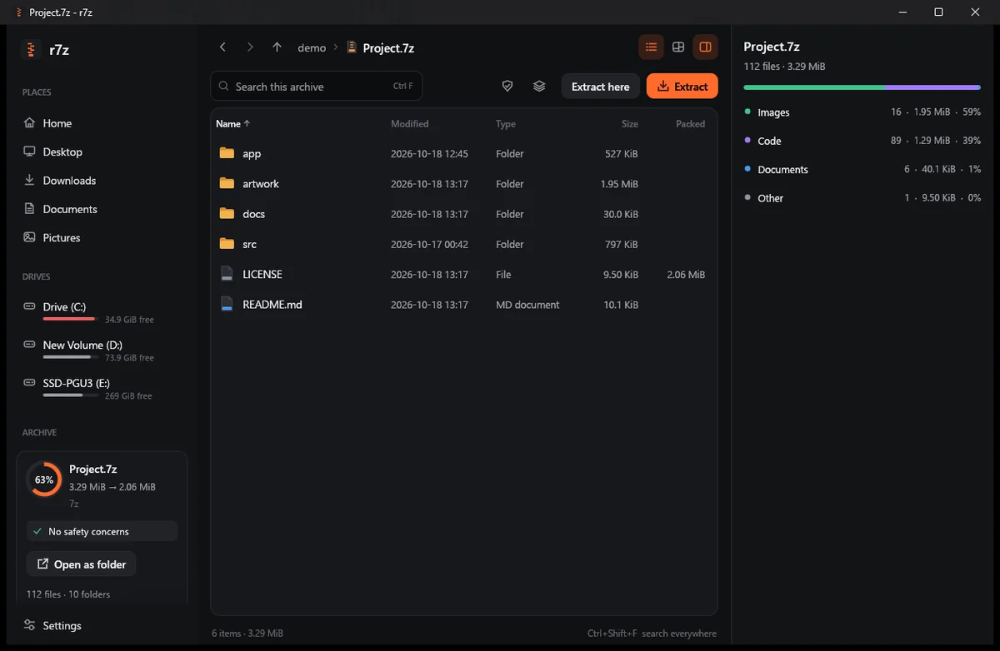

<p align="center">
  
</p>

<h1 align="center">r7z</h1>

<p align="center">
  A fast archiver for Windows, written in Rust.<br>
  Opens what 7-Zip opens, writes 7z, zip and tar, and extracts several times faster.
</p>

<p align="center">
  <a href="https://apps.microsoft.com/detail/9pk1s8689jln?referrer=appbadge&mode=direct"></a>
</p>

<p align="center">
  <a href="https://github.com/hdunl/r7z/releases/latest"></a>
  <a href="https://github.com/hdunl/r7z/actions/workflows/ci.yml"></a>
  <a href="https://scorecard.dev/viewer/?uri=github.com/hdunl/r7z"></a>
  <a href="https://www.bestpractices.dev/projects/15841"></a>
  <a href="https://github.com/hdunl/r7z/actions/workflows/codeql.yml"></a>
  <a href="https://github.com/hdunl/r7z/actions/workflows/cflite_batch.yml"></a>
  <a href="https://slsa.dev/spec/v1.0/levels#build-l2"></a>
  <a href="#license"></a>
  
  
</p>

<p align="center">
  
</p>

<p align="center">
  <a href="https://apps.microsoft.com/detail/9pk1s8689jln?referrer=appbadge&mode=direct"><b>Microsoft Store</b></a>
  ·
  <a href="https://github.com/hdunl/r7z/releases/latest"><b>Portable zip</b></a>
  ·
  <a href="docs/desktop-app.md">Desktop app</a>
  ·
  <a href="#usage">Command line</a>
  ·
  <a href="#performance">Benchmarks</a>
</p>

r7z comes as two programs: a command line tool that takes the same commands and switches
as 7-Zip's `7z.exe`, and a desktop app to replace the 7-Zip File Manager. Both are single
executables with no installer and no runtime to set up.

## Highlights

- **Fast extraction.** 2 to 6 times faster than 7-Zip on 7z, zip and compressed tar
  archives full of small files. Most of the time goes into creating files, so r7z writes
  them on a pool of threads and sets timestamps without reopening each file.
- **Faster compression at the default level.** 7z archives at `-mx5` come out 1.3 to 1.8
  times faster, from a parallel LZMA2 encoder whose output 7-Zip reads as is. `.tar.gz` is
  made in one step, about 8 times faster than piping two 7-Zip processes together.
- **Drop-in CLI.** `a`, `x`, `e`, `l`, `t`, `h` and `b` with 7-Zip's switches (`-o`, `-p`,
  `-mx`, `-mhe`, `-ao`, `-x!`, `@listfile` and the rest) and the same exit codes, so
  scripts keep working.
- **Works with 7-Zip both ways.** A 100-case matrix checks that archives r7z writes test
  and extract with 7-Zip, and the other way round. Archives can be updated in place
  (`a`, `u`, `d`, `rn`) for 7z, zip and tar; untouched 7z folders and zip entries are
  copied byte for byte.
- **Safe by default.** Paths that try to escape the destination are refused, archives
  are written to a temp file and renamed into place, and the desktop app flags zip bombs
  and disguised executables before you extract anything.
- **Rescues damaged archives.** `x -recover` gets back every file that can still be read
  from a truncated download or a corrupt archive, and says what happened to the rest.
- **Correct names from any language.** Zips made on a Japanese, Chinese, Korean or
  Russian PC show their real file names on every system instead of garbled text.

## Desktop app

<p align="center">
  
</p>

- Browse folders and archives in one window. Archives inside archives open in place.
- Preview images, text and hex without extracting, and paste a published SHA-256 or MD5 to
  check a download.
- **Space map:** see what takes room in an archive, down to single files.
- **Open as folder:** browse an archive in Explorer without extracting it. Uses Windows
  Projected File System, so no driver to install.
- **Smart extract:** creates a folder only when the archive needs one.
- **Undo extract:** take back the last five extractions, with any replaced files restored.
- Drag files out to Explorer, or copy and paste them.
- Batch extract, convert between formats, and create archives with AES-256.
- Light and dark themes that follow Windows, and Ctrl+Shift+F to search everywhere.
- **Right-click menu** in Explorer, including Windows 11's main menu: extract, test,
  convert to 7z, or compress to `.7z` or `.zip` in one click without opening the app.
- The portable version updates itself from GitHub releases. Every update is signed, and
  the signature is checked before anything is installed. The Store version updates
  through the Store.

The full list is in [docs/desktop-app.md](docs/desktop-app.md).

## Install

### Microsoft Store

[Get r7z from the Microsoft Store](https://apps.microsoft.com/detail/9pk1s8689jln?referrer=appbadge&mode=direct),
or from a terminal:

```bash
winget install --id 9PK1S8689JLN --source msstore
```

The Store version updates through the Store and comes with the right-click menu, "Open
with" for archive types and the `r7z` command, with nothing else to set up. It needs
Windows 10 version 2004 or later.

### Portable zip

Download the zip from [Releases](https://github.com/hdunl/r7z/releases/latest), unzip it
and run `r7z-gui.exe`. It works from any folder and updates itself. To have it in the
Start menu, Windows search and Installed apps, click **Install r7z** on the welcome tour's
last page or in Settings. That copies r7z to `%LOCALAPPDATA%\Programs\r7z` and needs no
administrator rights; uninstall it from Windows Settings → Apps. For the command line,
put `r7z.exe` on your `PATH` or run `r7z` after installing.

### From source

With a Rust toolchain:

```bash
cargo install --git https://github.com/hdunl/r7z r7z       # command line
cargo install --git https://github.com/hdunl/r7z r7z-gui   # desktop app
```

## Usage

```text
r7z a backup.7z Documents            # create (LZMA2, level 5, all cores)
r7z a secret.7z notes -p -mhe=on     # AES-256, file names encrypted too (prompts)
r7z a site.zip public_html -p        # zip with WinZip AES-256
r7z a src.tar.gz project             # tar + gzip in one step
r7z u backup.7z Documents            # update: replace only the files that changed
r7z d backup.7z "*.tmp"              # delete entries
r7z rn backup.7z Documents Docs      # rename an entry or a folder
r7z x backup.7z -oRestore            # extract with paths
r7z x linux-6.9.tar.xz               # the tar inside is extracted directly
r7z x package.deb                    # the files inside data.tar.*
r7z x broken.zip -recover -oRescued  # get back what is still readable
r7z l backup.7z "*.pdf"              # list matching entries
r7z t driver.cab                     # verify every checksum
r7z h -scrcSHA256 *.iso              # hash files
```

`r7z-gui file.7z` opens an archive in the desktop app. The Explorer menu entries call
`--extract-here`, `--extract-to`, `--test`, `--convert`, `--add`, `--add-7z` and
`--add-zip`.

## Formats

| | Formats |
|---|---|
| **Read and write** | 7z, zip (zstd members too), tar, gzip, bzip2, xz, zstd, lz4, Z (and `.tar.gz`, `.tar.bz2`, `.tar.xz`, `.tar.zst`, `.tar.lz4`, `.tar.Z` in one step) |
| **Read** | RAR 1.5 to RAR 5, lzma, lzma86, cab, cpio, ar and deb, rpm, arj, lzh, xar and pkg, wim, esd and swm, ISO 9660, UDF, DMG and HFS+ disk images, VHD, VHDX, VMDK and QCOW2 virtual disks, MBR and GPT partitions, FAT, exFAT, NTFS and ext2/3/4 file systems, split `.001` and `.z01` volumes, zip Shrink, Reduce and Implode, Base64, Intel HEX |
| **Zip-based** | jar, docx, xlsx, odt, epub, apk, ipa, appx, nupkg, whl |
| **Installers and executables** | MSI, MSP and other OLE (Compound) files, NSIS 2 and 3 and Inno Setup 5.5 to 6.7 installers, self-extracting 7z, zip and cab archives, PE resources (`-t PE`), CHM help |
| **Encryption** | 7z AES-256 with header encryption; zip WinZip AES (read and write) and ZipCrypto (read) |

Codecs, switches and per-format details: [docs/formats.md](docs/formats.md).

## Performance

Against 7-Zip 25.01 x64, on Windows 11 with 16 threads and an NVMe SSD. The test set is
87 MB in 6,554 files, mostly JavaScript. Each tool runs with its default settings.

| | r7z | 7-Zip | |
|---|---:|---:|---|
| Extract 7z (`-mx5`) | **1.24 s** | 5.11 s | 4.1x faster |
| Create 7z (`-mx5`) | **7.91 s** | 13.98 s | 1.8x faster, 5.7% larger |
| Extract zip | **0.86 s** | 5.34 s | 6.2x faster |
| Create zip | **0.82 s** | 1.23 s | 1.5x faster |
| Create `.tar.gz` | **1.01 s** | 8.15 s | 8.1x faster (7-Zip needs two steps) |
| Extract `.tar.gz` | **1.05 s** | 5.24 s | 5.0x faster |

Raw decoding speed (`t`) is 15 to 20% behind 7-Zip's hand-tuned assembly, and `-mx9` is
slower to create for now. The full tables, the method and how the parallel encoder works
are in [docs/performance.md](docs/performance.md). `scripts/compare.py` reproduces them.

## Building

Rust 1.95 or newer with the MSVC toolchain:

```bash
git clone https://github.com/hdunl/r7z
cd r7z
cargo build --release --workspace
```

This builds `target/release/r7z.exe` and `target/release/r7z-gui.exe`. The desktop app's
icon is compiled with `rc.exe` from the Windows SDK; without it the build still succeeds
with the default icon. Source layout and testing: [docs/development.md](docs/development.md).

## Roadmap

What r7z does not read or write yet is listed at the end of
[docs/formats.md](docs/formats.md#not-supported-yet).

## Security

| | |
|---|---|
| [OpenSSF Scorecard](https://scorecard.dev/viewer/?uri=github.com/hdunl/r7z) | Automated review of the repository's security practices, updated on every change |
| [OpenSSF Best Practices](https://www.bestpractices.dev/projects/15841) | Passing badge: a self-certified checklist of open source development and security practices |
| [Fuzzing](https://github.com/hdunl/r7z/actions/workflows/cflite_batch.yml) | Archive parsing and damaged-archive recovery are fuzzed on every pull request and daily; every crash found so far is fixed and kept as a regression test |
| [Code scanning](https://github.com/hdunl/r7z/actions/workflows/codeql.yml) | CodeQL and Clippy on every change |
| [Dependencies](https://github.com/hdunl/r7z/actions/workflows/ci.yml) | Locked, audited against the RustSec advisory database, and kept current by Dependabot |
| [Build provenance](https://github.com/hdunl/r7z/attestations) | Releases are built by GitHub Actions from a tag and carry SLSA provenance and a Sigstore bundle (`gh attestation verify`) |
| [Signed updates](.github/SECURITY.md#how-updates-work) | The app installs an update only if its manifest carries a valid Ed25519 signature and the version is newer |

Details, and how to report a vulnerability privately: [SECURITY.md](.github/SECURITY.md).

## Contributing

Bug reports and pull requests are welcome. For a bug, the output of `r7z t` on the archive
helps a lot, or `%APPDATA%\r7z\crash.log` if the desktop app closed. Please run
`cargo test --release` and `cargo clippy --workspace` before opening a pull request.

## License

Licensed under the [Apache License, Version 2.0](LICENSE).

Unless you explicitly state otherwise, any contribution intentionally submitted for
inclusion in this project by you, as defined in the Apache-2.0 license, shall be
licensed as above, without any additional terms or conditions.

## Acknowledgements

r7z is an independent implementation. It follows the formats as
[7-Zip](https://www.7-zip.org/) by Igor Pavlov writes and reads them, and the public format
specifications. It builds on [`lzma-rust2`](https://crates.io/crates/lzma-rust2),
[`flate2`](https://crates.io/crates/flate2), [`ruzstd`](https://crates.io/crates/ruzstd),
[`lz4_flex`](https://crates.io/crates/lz4_flex),
[`ppmd-rust`](https://crates.io/crates/ppmd-rust) and [egui](https://github.com/emilk/egui).
