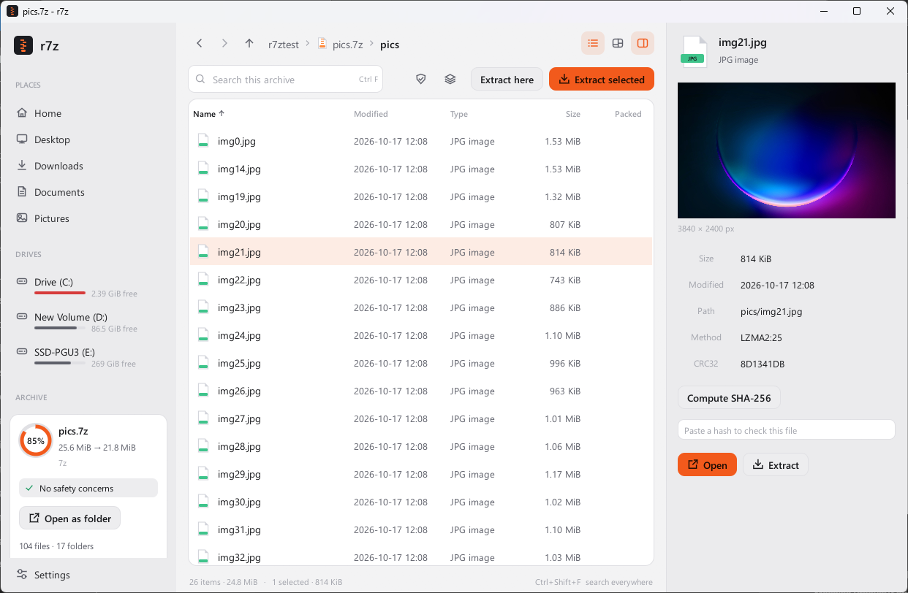
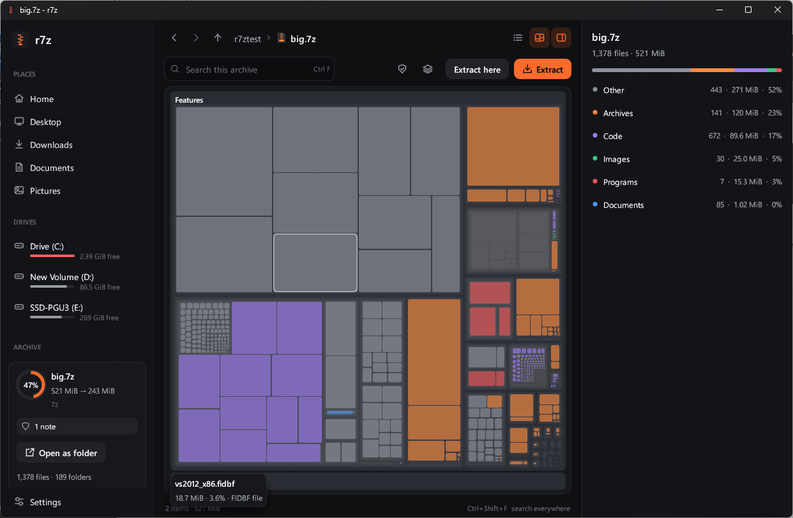

# Desktop app

`r7z-gui` is the windowed file manager, the counterpart of 7-Zip's 7zFM and 7zG. It is a
single 10 MB executable with no installer, and it starts instantly.



- **One window for disk and archives:** the sidebar has your folders, drives (with free
  space) and recent archives. Browse the disk, then open an archive with a double-click and
  keep going. Archives inside archives open in place, and the breadcrumb shows the whole
  path. The built-in browser replaces the Windows Open dialog (Ctrl+O still offers it).
- **Open as folder:** browse an archive in Explorer as an ordinary folder, without
  extracting it and without installing a driver. Use "Open as folder" on the archive card,
  on an archive's right-click menu, or in search everywhere. Explorer opens at
  `%LOCALAPPDATA%\r7z\mounts\<archive name>`, and any program can open, copy or preview
  the files there. Files are decoded when something first reads them; for solid 7z blocks,
  the files next to the one read are decoded into a temp cache (at most 1 GiB, less on a
  nearly full drive) so the next ones open without decoding the block again. The folder
  is read-only: creating, changing, deleting and renaming files is refused. Open folders
  are listed in the sidebar with an eject button; eject removes the folder and the copies
  Windows kept of the files read, and so does closing r7z. A folder left by a crash is
  removed the next time r7z starts. This uses Windows Projected File System (ProjFS), an
  optional feature of Windows 10 1809 and later that is off by default. If it is off,
  r7z says so; to turn it on, run this in PowerShell as administrator (r7z never changes
  it):

  ```powershell
  Enable-WindowsOptionalFeature -Online -FeatureName Client-ProjFS
  ```
- **Preview pane:** select a file to see it without extracting it. Images (PNG, JPEG, GIF,
  WebP, BMP, ICO, TIFF), text with encoding detection, a hex view for everything else, and
  a summary for nested archives. Large entries stream to a temporary file instead of
  memory. One click computes CRC32 and SHA-256. To check a download, paste its published
  hash under the preview: SHA-256, SHA-1, MD5 or CRC32, told apart by length, in any case.
  A whole checksum line works too (`SHA256 (file) = …` or `…  file`), and from a pasted
  SHA256SUMS list the line for the selected file is used. It says whether the file
  matches, for files on disk and inside archives alike.
- **Space map:** a treemap of what takes room in the current folder, colored by file type
  and nested down to individual files. Hover for name, size and share; double-click a
  folder to go in.
- **Safety check:** every archive is inspected when it opens. Paths that escape the
  destination, absolute paths, links, executables hidden behind double extensions, and
  extreme compression ratios (zip bombs) are reported on the archive card before you
  extract.
- **Right names from any country:** zips, LZH, ARJ and tar files whose names were written
  in Shift-JIS, GBK, Big5, Korean, Cyrillic, Greek or another legacy code page are listed
  correctly whatever your system language. The archive card shows the detected code page;
  pick another there and the archive is listed again.
- **Recover damaged archives:** when an archive will not open, or a test finds damage,
  "Recover files…" on the message or the archive card extracts everything still readable
  into a new `name (recovered)` folder and lists what was recovered, what is partial and
  what was lost, with the reason for each (see [Damaged archives](recovery.md)).
- **Smart extract:** "Extract here" makes a folder only when the archive has more than
  one top-level item, so it never scatters files or nests `name/name/`. Select several
  archives on disk to extract them all in one batch.
- **Undo extract:** every extraction can be taken back. The toast at the end has an
  Undo button, and "Undo last extract" is in search everywhere. Files an extraction
  replaces are moved aside first (to `%TEMP%\r7z-undo`) rather than overwritten, so undo
  puts them back. Undo deletes only files that still have the size and time they were
  written with, so anything you edited since is left alone; an original whose file you
  edited is put back next to it as `name (before extract).ext`. Folders the extraction
  made are removed once empty. The last 5 extractions can be undone, also after a
  restart; their records are in `%APPDATA%\r7z\undo`, and older backups are deleted when
  the app starts. An extraction you stopped halfway can be undone too.
- **Drag out and copy:** drag files from an archive to Explorer, the desktop or any
  program that accepts files, and they are extracted there. Ctrl+C (or Copy on the
  right-click menu) puts them on the clipboard for pasting anywhere. Both extract to a temp
  folder first. Progress shows in the activity card and the window stays usable; if you
  drop before extraction finishes, the drop waits for it (Esc cancels). Dragging or
  copying files from a disk folder hands over the real files. Ctrl+V in a disk folder
  pastes files copied in Explorer or in r7z. Temp copies are removed when a drag is
  cancelled and when the app closes, except copies still on the clipboard: those stay
  pasteable, and a later run of r7z removes them once they are half a day old.
- **Convert:** re-pack an archive into another format (for example zip to 7z) in one step.
- **Create:** drop files or folders on the window, or use New archive. Choose 7z, zip,
  tar, tar.gz, tar.xz or tar.bz2, a level from Store to Ultra, solid mode, and an AES-256
  password. 7z can also hide file names.
- **Jobs:** extraction, testing and compression run in the background with progress,
  speed and time left. Further jobs queue behind the running one. Cancel stops promptly
  and leaves no partial archive. When a file already exists you choose Replace, Skip, Keep
  both, or apply your answer to all.
- **Search everywhere:** Ctrl+Shift+F finds files, folders, places, recent archives
  and actions from one box. Ctrl+F searches the whole archive, Ctrl+E extracts, Space
  toggles the preview, Alt+arrows move back and forward, and Enter opens.
- **Look:** light and dark themes that follow Windows (or set one in Settings), including
  the title bar. Text uses Segoe UI, and the icons are vector-drawn. CJK fonts load only
  when a name needs them.
- **Explorer integration:** Settings → "Add to menu" adds "Open with r7z", "Extract here",
  "Extract to folder" and "Add to archive…" to the right-click menu. It writes per-user
  registry keys only (no administrator rights); "Remove from menu" deletes them. These
  verbs call `r7z-gui --extract-here|--extract-to|--add <paths>`; with several archives
  selected, "Extract here" runs one batch and "Extract to" asks for one destination.
  On Windows 11 those entries sit under "Show more options". Windows 11's main menu
  only takes commands from packaged apps, so r7z also registers a small package
  (`package\AppxManifest.xml`) whose command handler, `r7z_shell.dll`, adds an **r7z**
  submenu there. Windows installs such a package only when it is signed with a trusted
  certificate; releases ship it signed as `r7z-shell.msix`, so Settings → "Add to menu"
  puts r7z in the main menu on any Windows 11 PC. Development builds use the loose
  manifest instead, which registers only with Developer Mode on.
- **Updates:** once a day r7z checks GitHub for a newer release and offers it in a
  toast; Settings → Updates has "Check now", and options to stop checking or to install
  updates without asking. Each release's manifest is signed with Ed25519 and checked
  against a key built into the app, the download is checked against the hash in the
  manifest, and only newer versions are accepted. The new `r7z-gui.exe` (and `r7z.exe`,
  when it is in the same folder) replaces the old one, which is kept as `.old` until the
  next start; "Restart now" switches over. See [SECURITY.md](../SECURITY.md).
- **Welcome tour:** on the first normal launch, a short tour shows the main features
  with screenshots. Skip it with the button or Esc; Settings → "Welcome tour" and search
  everywhere open it again.
- **Crash reports:** if something goes wrong, the error is written to
  `%APPDATA%\r7z\crash.log`. A failure inside a background job is reported as an error
  and does not close the window.



On some Windows 11 builds, the standard Open dialog draws a black strip along its top
edge. This happens in every program that uses that dialog, so the built-in browser is the
default.
